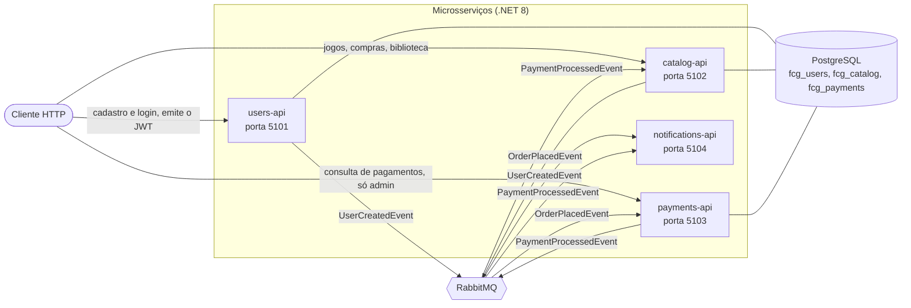
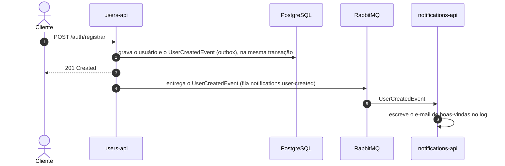
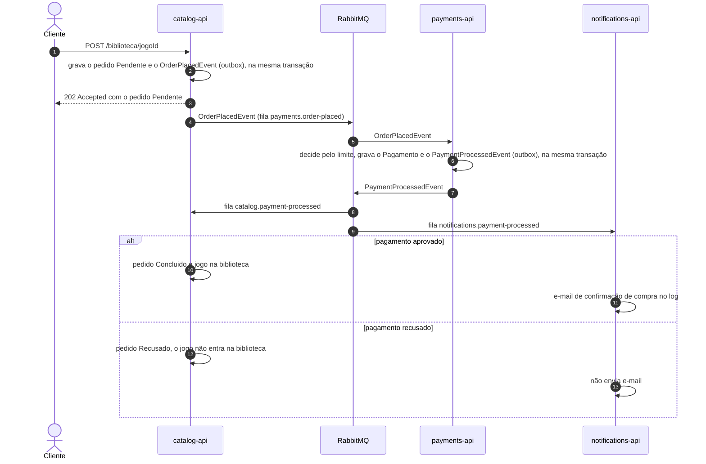

# fcg-orchestration

Orquestração da **FIAP Cloud Games (FCG), Fase 2** do Tech Challenge. Na Fase 1 a plataforma era um monólito; aqui ela foi dividida em quatro microsserviços .NET 8 que conversam por eventos no RabbitMQ. Este repositório não tem código de aplicação: ele junta as peças, com o `docker-compose.yml` que sobe tudo com um comando e os manifestos de Kubernetes da infraestrutura (RabbitMQ e PostgreSQL) mais os scripts de deploy.

Os serviços ficam em repositórios próprios:

| Repositório | Papel | Porta local |
|---|---|---|
| [fcg-users-api](https://github.com/PedroRCampelo/fcg-users-api) | Cadastro, login e emissão do JWT. Publica `UserCreatedEvent` | 5101 |
| [fcg-catalog-api](https://github.com/PedroRCampelo/fcg-catalog-api) | Jogos, promoções, pedidos e biblioteca. Publica `OrderPlacedEvent` e consome `PaymentProcessedEvent` | 5102 |
| [fcg-payments-api](https://github.com/PedroRCampelo/fcg-payments-api) | Pagamento simulado. Consome `OrderPlacedEvent` e publica `PaymentProcessedEvent` | 5103 |
| [fcg-notifications-api](https://github.com/PedroRCampelo/fcg-notifications-api) | E-mails simulados (escritos no log). Consome `UserCreatedEvent` e `PaymentProcessedEvent` | 5104 |

Cada um tem um README com os eventos, os endpoints, a tabela de variáveis de ambiente e como rodar isolado.

## Visão geral da arquitetura



- **Comunicação:** os serviços não chamam uns aos outros por HTTP. Toda a conversa entre eles é por evento (MassTransit sobre RabbitMQ), o que deixa cada um subir, cair e escalar sem arrastar os outros.
- **Dados:** um único container PostgreSQL com um database por serviço (`fcg_users`, `fcg_catalog`, `fcg_payments`). Nenhum serviço lê o banco do outro. O Notifications não tem banco.
- **Autenticação:** só o Users emite o JWT. Catalog e Payments apenas validam o token, com a mesma chave de assinatura, entregue pela variável `JWT__SIGNINGKEY`. O Notifications não expõe nada além de `/health`, então não valida token.

## Fluxos de evento

### Fluxo 1: cadastro e e-mail de boas-vindas



### Fluxo 2: compra, nos dois desfechos



Pontos que valem notar:

- A compra é **assíncrona**. O `POST /biblioteca/{jogoId}` responde 202 com o pedido ainda `Pendente`; o desfecho aparece em `GET /pedidos` uma fração de segundo depois.
- O Payments aprova quando `Price` é **menor ou igual** a um limite configurável (200 por padrão): 200,00 é aprovado, 200,01 é recusado.
- Cada fila é declarada por quem **publica**, na subida. Por isso nenhum evento se perde se o consumidor ainda não estiver de pé: ele espera na fila (veja as decisões abaixo).

## Pré-requisito: os cinco repositórios lado a lado

O `docker-compose.yml` constrói as imagens a partir dos repositórios vizinhos (`../fcg-users-api` e assim por diante) e os scripts do Kubernetes procuram os manifestos dos serviços em `../../fcg-*-api`. Por isso os cinco precisam estar clonados **na mesma pasta**, com estes nomes:

```bash
mkdir fcg-fase2 && cd fcg-fase2
git clone https://github.com/PedroRCampelo/fcg-orchestration.git
git clone https://github.com/PedroRCampelo/fcg-users-api.git
git clone https://github.com/PedroRCampelo/fcg-catalog-api.git
git clone https://github.com/PedroRCampelo/fcg-payments-api.git
git clone https://github.com/PedroRCampelo/fcg-notifications-api.git
```

Ficando assim:

```
fcg-fase2/
  fcg-orchestration/      <- você roda os comandos daqui
  fcg-users-api/
  fcg-catalog-api/
  fcg-payments-api/
  fcg-notifications-api/
```

Também é preciso ter o **Docker Desktop** (com Kubernetes habilitado, se for usar a seção de Kubernetes). O SDK do .NET só é necessário para rodar os serviços fora do Docker.

## Configuração: o arquivo .env

```bash
cd fcg-orchestration
cp .env.example .env
```

Abra o `.env` e preencha a única variável obrigatória, a chave de assinatura do JWT (pelo menos 32 caracteres). Para gerar uma:

```bash
openssl rand -hex 32
```

O `.env` não é versionado. O compose se recusa a subir sem a chave, e os serviços também (não existe valor padrão em lugar nenhum). Mesmo para comandos que só tocam na infraestrutura, como `docker compose up rabbitmq postgres`, o compose valida o arquivo inteiro, então o `.env` precisa existir.

| Variável | Descrição | Obrigatória | Padrão |
|---|---|---|---|
| `JWT__SIGNINGKEY` | Chave de assinatura do JWT, compartilhada por users, catalog e payments | Sim | Nenhum |
| `RABBITMQ_USER` | Usuário do RabbitMQ | Não | `fcg` |
| `RABBITMQ_PASSWORD` | Senha do RabbitMQ | Não | `fcg_password` |
| `RABBITMQ_AMQP_PORT` | Porta AMQP publicada no host | Não | `5672` |
| `RABBITMQ_MANAGEMENT_PORT` | Porta do painel do RabbitMQ no host | Não | `15672` |
| `POSTGRES_USER` | Usuário do PostgreSQL | Não | `fcg` |
| `POSTGRES_PASSWORD` | Senha do PostgreSQL | Não | `fcg_password` |
| `POSTGRES_HOST_PORT` | Porta do PostgreSQL publicada no host (dentro da rede do compose é sempre 5432) | Não | `5435` |
| `USERS_API_PORT` | Porta do users-api no host | Não | `5101` |
| `CATALOG_API_PORT` | Porta do catalog-api no host | Não | `5102` |
| `PAYMENTS_API_PORT` | Porta do payments-api no host | Não | `5103` |
| `NOTIFICATIONS_API_PORT` | Porta do notifications-api no host | Não | `5104` |
| `PAYMENTS_LIMITE_DE_APROVACAO` | Limite de aprovação do pagamento simulado (ponto decimal) | Não | `200` |

O PostgreSQL usa a 5435 no host porque a 5432 costuma estar ocupada por uma instalação local; mude `POSTGRES_HOST_PORT` se a 5435 também estiver.

## Executando com Docker Compose

Com os repositórios lado a lado e o `.env` preenchido, a aplicação inteira (RabbitMQ, PostgreSQL e os quatro serviços) sobe com:

```bash
docker compose up --build
```

Na primeira vez ele baixa as imagens base e constrói as quatro imagens (`fcg-<serviço>:local`), o que leva alguns minutos. Nas seguintes, o cache de camadas deixa o build rápido. O `--build` garante que uma alteração de código seja refletida; sem ele, o compose reaproveita as imagens já construídas.

O que acontece na subida: o PostgreSQL cria os três databases (script em `postgres-init/`, executado só quando o volume está vazio), cada serviço espera o banco e o RabbitMQ ficarem saudáveis, aplica suas migrações e declara as filas que precisa. Para vê-los prontos:

```bash
docker compose ps
```

Todos devem aparecer como `healthy`. Depois disso:

| O que | Onde |
|---|---|
| Swagger do Users | http://localhost:5101/swagger |
| Swagger do Catalog | http://localhost:5102/swagger |
| Swagger do Payments | http://localhost:5103/swagger |
| Saúde do Notifications | http://localhost:5104/health |
| Painel do RabbitMQ | http://localhost:15672 (`fcg` / `fcg_password`) |

Comandos úteis:

```bash
docker compose logs -f notifications-api      # onde os e-mails aparecem
docker compose down                           # para tudo, mantém os dados
docker compose down -v                        # para tudo e APAGA os dados (bancos e filas)
```

Se alguma das portas já estiver em uso, mude a variável correspondente no `.env`.

## Executando no Kubernetes (Docker Desktop)

Foi testado no cluster do Docker Desktop, no modo em que o cluster usa o mesmo daemon Docker da sua máquina (o `kubeadm`) e, por isso, enxerga as imagens construídas localmente. Não foi testado em outros clusters (kind, minikube); neles seria preciso colocar as imagens num registry ou carregá-las no cluster, porque os manifestos usam `imagePullPolicy: IfNotPresent` e as imagens `fcg-*:local` não existem em nenhum registry.

**1. Habilite o Kubernetes.** No Docker Desktop: Settings, Kubernetes, Enable Kubernetes. Confirme com:

```bash
kubectl config current-context     # docker-desktop
kubectl get nodes                  # deve mostrar o nó como Ready
```

**2. Construa as imagens** (os manifestos esperam as quatro, no daemon local):

```bash
docker compose build
```

**3. Faça o deploy.** Pare antes a stack do compose, se estiver rodando (`docker compose down`), porque ela ocupa as mesmas portas que o passo 4 usa.

```bash
./k8s/deploy.sh
```

O script cria o namespace `fcg`, cria o Secret da chave JWT a partir do `.env`, sobe o PostgreSQL e o RabbitMQ, espera os dois ficarem prontos e então aplica os manifestos de cada serviço (a pasta `k8s/` de cada repositório). Pode ser executado de novo sem problema. No fim ele lista os pods; todos devem estar `Running` e `1/1`:

```bash
kubectl get pods -n fcg
```

**4. Exponha os serviços** com `port-forward`, nas mesmas portas do compose:

```bash
./k8s/port-forward.sh
```

O script fica em primeiro plano (Ctrl+C encerra) e refaz cada redirecionamento sozinho se um pod for trocado. Se o painel do RabbitMQ (15672) estiver ocupado, use `RABBITMQ_MANAGEMENT_PORT=15673 ./k8s/port-forward.sh`. Com o túnel ativo, tudo da seção a seguir funciona igual ao compose.

**5. Veja os e-mails e remova tudo quando quiser:**

```bash
kubectl logs -n fcg deploy/notifications-api     # onde os e-mails aparecem
./k8s/destroy.sh                                 # apaga o namespace fcg, inclusive os volumes
```

### O que tem em cada pasta k8s

| Onde | O quê |
|---|---|
| `fcg-orchestration/k8s/` | Namespace `fcg`, PostgreSQL e RabbitMQ (StatefulSets com volume persistente), o ConfigMap com os `CREATE DATABASE`, o modelo do Secret da chave JWT e os scripts `deploy.sh`, `create-jwt-secret.sh`, `port-forward.sh` e `destroy.sh` |
| `fcg-<serviço>/k8s/` | `deployment.yaml`, `service.yaml` (com o nome `users-api`, `catalog-api`, `payments-api` ou `notifications-api`), `configmap.yaml` (host do RabbitMQ, nomes das filas, e o limite de aprovação no Payments) e `secret.yaml` (connection string e credenciais do RabbitMQ) |

Detalhes que mudam o comportamento:

- **Probes.** A `startupProbe` (90 tentativas de 5 s) cobre a espera por banco e RabbitMQ na subida; só depois dela entram a `readinessProbe` e a `livenessProbe`. A readiness usa `/health`, que inclui a conexão com o broker. A liveness usa `/health/live`, que não depende de nada externo, para que uma queda do RabbitMQ não reinicie os pods à toa.
- **Chave JWT.** Existe um único Secret, `jwt-signing-key`, lido por users, catalog e payments. Ele é criado a partir do `.env` por `k8s/create-jwt-secret.sh` e nunca vai para o git. O modelo `k8s/jwt-secret.yaml.example` tem a extensão `.example` de propósito, para o `kubectl apply -f k8s/` não o aplicar e sobrescrever a chave real.
- **Dados.** O PostgreSQL e o RabbitMQ usam volumes persistentes: recriar um pod não perde dados nem mensagens retidas.

## Testando o fluxo de compra

Os comandos abaixo valem para o compose e para o Kubernetes com `port-forward` (mesmas portas). Eles usam o administrador criado no primeiro start (`admin@fcg.com` / `Admin123!`).

```bash
# 1. Token do administrador
ADMIN=$(curl -s -X POST http://localhost:5101/auth/login -H 'content-type: application/json' \
  -d '{"email":"admin@fcg.com","senha":"Admin123!"}' | sed -E 's/.*"token":"([^"]+)".*/\1/')

# 2. Dois jogos: um de 100 (será aprovado) e um de 250 (será recusado, o limite é 200)
BARATO=$(curl -s -X POST http://localhost:5102/jogos -H 'content-type: application/json' -H "authorization: Bearer $ADMIN" \
  -d '{"titulo":"Jogo de 100","descricao":"aprovado","preco":100.00}' | sed -E 's/.*"id":"([^"]+)".*/\1/')
CARO=$(curl -s -X POST http://localhost:5102/jogos -H 'content-type: application/json' -H "authorization: Bearer $ADMIN" \
  -d '{"titulo":"Jogo de 250","descricao":"recusado","preco":250.00}' | sed -E 's/.*"id":"([^"]+)".*/\1/')

# 3. Um usuário comum (isso já dispara o e-mail de boas-vindas)
curl -s -X POST http://localhost:5101/auth/registrar -H 'content-type: application/json' \
  -d '{"nome":"Ana","email":"ana@exemplo.com","senha":"Senha123!"}'
TOKEN=$(curl -s -X POST http://localhost:5101/auth/login -H 'content-type: application/json' \
  -d '{"email":"ana@exemplo.com","senha":"Senha123!"}' | sed -E 's/.*"token":"([^"]+)".*/\1/')

# 4. As duas compras (respondem 202 com o pedido ainda Pendente)
curl -s -X POST http://localhost:5102/biblioteca/$BARATO -H "authorization: Bearer $TOKEN"
curl -s -X POST http://localhost:5102/biblioteca/$CARO -H "authorization: Bearer $TOKEN"

# 5. Um instante depois: o desfecho
curl -s http://localhost:5102/pedidos -H "authorization: Bearer $TOKEN"
curl -s http://localhost:5102/biblioteca -H "authorization: Bearer $TOKEN"
curl -s http://localhost:5103/pagamentos -H "authorization: Bearer $ADMIN"
```

As respostas saem em JSON numa linha só. Para ler melhor, acrescente `| python3 -m json.tool` (ou `| jq`) ao final de qualquer `curl` do passo 5.

O esperado:

- **Jogo de 100:** pedido `Concluido`, o jogo aparece na biblioteca, pagamento `Aprovado` e um e-mail de confirmação no log do notifications-api.
- **Jogo de 250:** pedido `Recusado`, o jogo **não** aparece na biblioteca, pagamento `Recusado` e nenhum e-mail.
- No log do notifications-api, o e-mail de boas-vindas da Ana também aparece.

Para os e-mails: `docker compose logs notifications-api | grep "E-MAIL ENVIADO"` no compose, ou `kubectl logs -n fcg deploy/notifications-api | grep "E-MAIL ENVIADO"` no Kubernetes.

## Decisões de projeto

Estas são as escolhas que moldam o sistema, com o motivo de cada uma e o que elas custam.

### Contratos de evento duplicados em cada repositório

Cada evento (`UserCreatedEvent`, `OrderPlacedEvent`, `PaymentProcessedEvent` e o enum `PaymentStatus`) existe como uma **cópia idêntica** na pasta `Contracts/` de todo repositório que o usa, em vez de um pacote compartilhado.

- **Por quê:** um pacote comum acoplaria os quatro serviços numa mesma versão de uma biblioteca e exigiria um feed de pacotes só para isso. Com cópias, cada serviço continua independente: compila, testa e vai para produção sem depender de nenhum outro repositório.
- **Custo:** as cópias podem divergir. A regra é que os arquivos sejam **byte a byte iguais** (mesmo namespace, `FCG.Contracts`), e dá para conferir com um comando; cada grupo de arquivos deve aparecer com uma única soma:

  ```bash
  for f in UserCreatedEvent OrderPlacedEvent PaymentProcessedEvent PaymentStatus; do
    echo "$f"; shasum -a 256 ../fcg-*-api/src/*/Contracts/$f.cs | awk '{print "  " substr($1,1,12)}' | sort | uniq -c
  done
  ```

  Além disso, cada repositório que usa o `PaymentStatus` tem testes que leem o JSON de verdade e travam o formato.

### Nomes de fila repetidos nos ConfigMaps

Os nomes das filas (`notifications.user-created`, `payments.order-placed`, `catalog.payment-processed`, `notifications.payment-processed`) aparecem no `k8s/configmap.yaml` de cada serviço que os usa, em vez de um ConfigMap único e compartilhado.

- **Por quê:** cada repositório fica autossuficiente. `kubectl apply -f k8s/` num serviço funciona sem que outro repositório tenha criado nada antes, o que combina com a decisão de manter os serviços independentes.
- **Custo:** o nome precisa ser igual em quem declara a fila (o publicador) e em quem consome. Se divergirem, o publicador declara uma fila que ninguém escuta e os eventos ficam parados, sem erro visível. Por isso os valores dos ConfigMaps foram conferidos contra o `appsettings.json` de cada serviço. Ao mudar um nome, mude em todos.

### Credenciais padrão nos Secrets

Os `secret.yaml` dos serviços e os Secrets do PostgreSQL e do RabbitMQ trazem as credenciais de desenvolvimento (`fcg` / `fcg_password`), as mesmas do compose, escritas no repositório.

- **Por quê:** o objetivo é que `./k8s/deploy.sh` funcione logo após o clone, sem etapas manuais de criação de segredos, num cluster local descartável. Esses valores já eram públicos no compose e nos `appsettings.Development.json`.
- **Custo e limite:** servem **só para uso local**. Em qualquer outro ambiente, troque-os (de preferência por um gerenciador de segredos) nos três lugares que precisam concordar: o Secret do banco ou do broker e as connection strings dos serviços. A **chave do JWT é a exceção e nunca é versionada**: vem do `.env` e é criada no cluster por script.

### Outbox no Users e no consumidor do Payments

Quem grava no banco e também publica um evento tem o problema da escrita dupla: se o banco confirmar e a publicação falhar (ou o contrário), os dois lados ficam inconsistentes. O sistema resolve com o outbox transacional do MassTransit com Entity Framework: o evento é gravado numa tabela, na **mesma transação** do dado, e um processo separado o entrega ao RabbitMQ depois.

- **No Users:** o usuário e o `UserCreatedEvent` são confirmados juntos. Nunca existe cadastro sem evento nem evento de um cadastro que não aconteceu, e se o RabbitMQ estiver fora do ar o evento espera no banco. (O Catalog usa o mesmo mecanismo para o `OrderPlacedEvent`.)
- **No consumidor do Payments:** aqui há uma sutileza. O Payments publica o `PaymentProcessedEvent` de **dentro** de um consumidor, e o outbox comum do bus não cobre esse caso: a publicação iria direto ao broker, antes do commit. Se a gravação do `Pagamento` falhasse depois disso, o evento já teria saído para um pagamento que não existe. Por isso o outbox é aplicado também no endpoint do consumidor (inbox e outbox do Entity Framework), e o `Pagamento` e o evento são confirmados juntos. Isso foi verificado no sistema real: um gatilho no banco fez o `INSERT` do pagamento falhar depois do `Publish`, e nenhum evento chegou ao broker.
- **Custo:** uma tabela de outbox por banco e um pequeno atraso entre o commit e a entrega do evento.

### Idempotência pelo OrderId

O RabbitMQ garante entrega **pelo menos uma vez**, então a mesma mensagem pode chegar mais de uma vez (reentrega depois de uma falha, ou uma duplicata). Os dois consumidores de pedidos são idempotentes tendo o `OrderId` como chave:

- **Catalog:** ao receber o `PaymentProcessedEvent`, se o pedido já não estiver `Pendente`, a mensagem é descartada sem efeito, com um log que explica o motivo.
- **Payments:** ao receber o `OrderPlacedEvent`, se já existir um pagamento para aquele `OrderId`, a mensagem é descartada, sem reprocessar e sem publicar o evento de novo.
- **Garantia no banco:** índices únicos cobrem a corrida entre duas mensagens simultâneas (o `PedidoId` no Payments; `(UsuarioId, JogoId)` na biblioteca e um índice único parcial para pedidos pendentes no Catalog).
- **Fora do alcance:** o Notifications não deduplica. Uma reentrega geraria um segundo e-mail, o que foi aceito por ele ser simulado.

Nos testes com 10 duplicatas concorrentes por pedido, houve exatamente um pagamento e um `PaymentProcessedEvent` em cada caso. A colisão no índice único, que dispara uma nova tentativa, não chegou a ocorrer nessa corrida ao vivo; ela é coberta por testes automatizados e por uma verificação direta contra o banco.

### Preço sem desconto no OrderPlacedEvent

O `OrderPlacedEvent` leva o **preço cheio** do jogo no momento da compra (`Price`). As promoções existem (cadastro e listagem), mas não são aplicadas ao valor do pedido.

- **Por quê:** a especificação pedia o cadastro de promoções, mas não dizia que elas deveriam alterar o preço cobrado. Aplicar um desconto sem uma regra definida (qual promoção vale se houver duas, como tratar datas e fusos) seria inventar comportamento. O pedido guarda o preço do jogo naquele momento, de modo que mudanças posteriores no preço do catálogo não alteram pedidos antigos.
- **Custo:** quem cadastra uma promoção não vê efeito na compra. É uma lacuna conhecida, e o ponto para fechá-la é o `PedidoService` do Catalog, antes de montar o `OrderPlacedEvent`.

### EF Core 9 sobre .NET 8

Os serviços compilam para **.NET 8** (versão LTS), mas usam **Entity Framework Core 9** (9.0.21) com o provedor Npgsql 9.0.4.

- **Por quê:** o pacote `MassTransit.EntityFrameworkCore` 8.5.11, que fornece o outbox e o inbox, depende do EF Core 9. O EF Core 9 tem alvo `net8.0`, então roda sem problema no .NET 8. Subir o .NET para a versão 9 não era necessário, e o MassTransit ficou na série 8 porque a série 9 é comercial.
- **Cuidado:** o `Microsoft.EntityFrameworkCore.Relational` também é fixado em 9.0.21 de forma explícita, para evitar um aviso de versões divergentes. A ferramenta `dotnet-ef` (9.0.21) está como ferramenta local do repositório (`.config/dotnet-tools.json`), e as migrações são geradas por uma fábrica de design-time na camada de infraestrutura, sem precisar subir a aplicação.

### Outras decisões que sustentam o desenho

- **Quem publica declara a fila de quem consome.** O RabbitMQ descarta uma mensagem publicada numa exchange que ainda não tem fila ligada. Para que um evento publicado antes de o consumidor subir não seja perdido, o publicador declara a fila e o binding do consumidor na própria subida. O Users, que só publica, faz isso no próprio bus (em modo de declaração de topologia); Catalog e Payments, que também consomem, usam um bus separado só para declarar as filas, que sobe e desliga antes do bus principal.
- **Uma só chave de JWT, um só emissor.** Só o Users emite o token; os demais apenas validam. As claims usam os nomes curtos do JWT (`sub`, `email`, `name`, `role`) e a chave nunca tem valor padrão: sem ela o serviço não sobe.
- **`PaymentStatus` com valores fixos e em texto.** O enum é `Approved = 1` e `Rejected = 2`, e vai como texto no JSON. O valor 0 fica indefinido de propósito, para que um campo ausente nunca seja lido como aprovado, e o texto impede que reordenar o enum troque o significado em silêncio.
- **Um PostgreSQL, três databases.** Isolamento de dados por serviço sem multiplicar containers numa máquina de desenvolvimento.
- **Migrações no startup.** Cada serviço aplica as suas ao subir, com novas tentativas até o banco responder. Simplifica o `docker compose up` e o deploy, ao custo de que, com várias réplicas, todas tentariam migrar juntas.
- **Dockerfiles multi-stage com build cruzado.** O estágio de build roda na arquitetura da máquina e compila para a de destino (`-a $TARGETARCH`), sem emulação, então a mesma imagem sai para arm64 e amd64. A imagem final tem só o runtime do ASP.NET (sem SDK nem código-fonte) e roda sem privilégios de root.
- **Erros e logs padronizados.** Exceções viram respostas ProblemDetails (RFC 7807) por um middleware global, e os logs saem em JSON (Serilog) no console.

## Limitações conhecidas

- O pagamento e o envio de e-mail são **simulados**. O Notifications não deduplica reentregas.
- As promoções não alteram o preço do pedido (veja acima).
- Os nomes de fila repetidos nos ConfigMaps dependem de disciplina para continuar iguais.
- Cada serviço roda com **uma réplica** no Kubernetes. O desenho é idempotente, mas escalar para várias réplicas não foi exercitado.
- Não há Ingress: o acesso de fora do cluster é por `port-forward`.
- Na primeira subida de um banco novo aparecem algumas linhas de aviso e de erro nos logs que não indicam falha: o EF consulta a tabela de histórico de migrações antes de ela existir, o MassTransit tenta conectar ao RabbitMQ até ele estar pronto, e o `/health` responde 503 enquanto o serviço ainda inicia.
- O Docker Desktop pode apagar imagens sem uso. Se isso acontecer com as `fcg-*:local`, rode `docker compose build` de novo antes do deploy.

## Estrutura deste repositório

```
fcg-orchestration/
  docker-compose.yml             RabbitMQ, PostgreSQL e os quatro serviços
  .env.example                   modelo do .env (o .env real não é versionado)
  postgres-init/
    01-create-databases.sql      cria os três databases na primeira subida do PostgreSQL
  k8s/
    00-namespace.yaml            namespace fcg
    postgres.yaml                StatefulSet, Service, Secret e ConfigMap com os CREATE DATABASE
    rabbitmq.yaml                StatefulSet, Service e Secret
    jwt-secret.yaml.example      modelo do Secret da chave JWT (o real é criado pelo script)
    create-jwt-secret.sh         cria o Secret jwt-signing-key a partir do .env
    deploy.sh                    aplica tudo na ordem certa e espera os pods
    port-forward.sh              expõe os serviços no localhost, nas portas do compose
    destroy.sh                   apaga o namespace fcg
```
